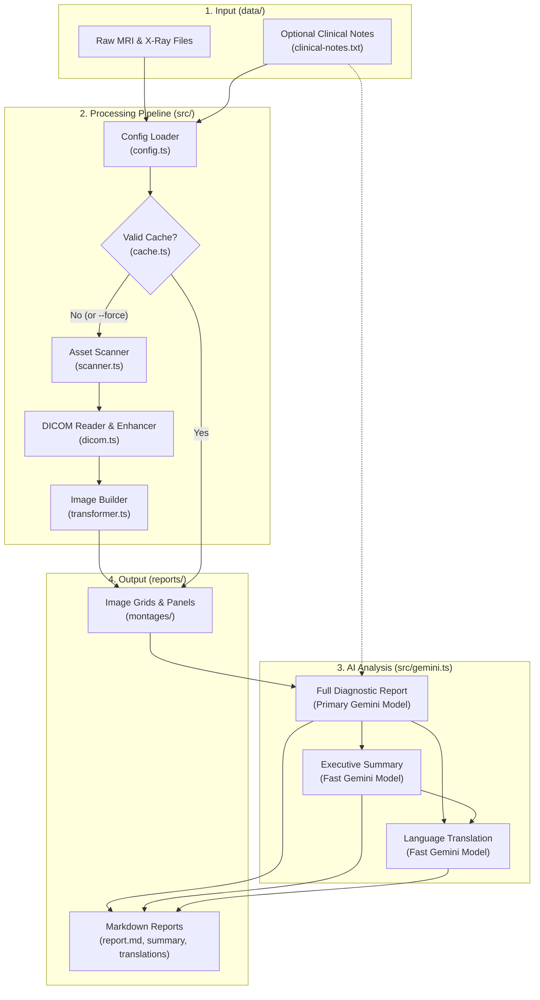

# Doctor Lens Architecture

## Overview

**Doctor Lens** is a command-line tool that turns raw medical scans (MRI and X-Ray files) into clear, easy-to-read diagnostic reports using Google Gemini AI.

Medical imaging CDs or exports usually contain hundreds of raw scan files (called DICOM files) that are difficult to view without specialized software. Doctor Lens automatically finds these files, converts them into clear, high-contrast image grids, and sends them to Google Gemini to generate a detailed medical report, an easy-to-understand summary, and translations in your preferred language.

---

## Architecture Diagram

---

## How It Works (Step-by-Step)

When you run `npm run diagnose -- --body-part-id <case-id>`, the pipeline runs in four main steps:

1. **Load or Transform Images**: It checks if the scans for that case have already been converted into images. If not, it scans the `data/<case-id>` folder, reads the raw MRI and X-Ray files, cleans up the images, and builds organized image grids inside `reports/<case-id>/montages/`.
2. **Generate Full Report**: It sends the generated images (plus any patient symptom notes from `clinical-notes.txt`) to the main Gemini AI model, which writes a thorough radiological report (`report.md`).
3. **Create Executive Summary**: Once the main report is saved, a faster Gemini model reads it and creates a short, plain-language summary (`report-summary.md`).
4. **Translate Reports**: Finally, both the full report and the summary are translated into your target language (for example, Spanish `es-ES`).

---

## Core Components

Each file in `src/` handles a single part of the workflow:

- **`src/index.ts` (Main Coordinator)**: Runs the 4-step pipeline from start to finish and prints progress in the terminal.
- **`src/config.ts` (Configuration)**: Reads command-line flags (like `--body-part-id` and `--force-transform`), environment settings (API keys, AI models, target language), and optional patient notes (`clinical-notes.txt`).
- **`src/scanner.ts` (File Scanner)**: Searches the `data/<case-id>/mri` and `data/<case-id>/x-ray` folders for valid medical scans while ignoring extra CD viewer programs or system files.
- **`src/dicom.ts` (Scan Reader)**: Opens raw DICOM files, strips out personal patient information for privacy, adjusts image brightness and contrast, and finds the exact area where the body part is located so empty black borders can be trimmed.
- **`src/transformer.ts` (Image Builder)**: Uses the `sharp` image library to turn individual scan slices into PNG image grids:
  - **Overview Montages**: A single image showing all slices of a scan sequence in order.
  - **High-Resolution Detail Panels**: Zoomed-in groups of 6 slices with sharpened details and a millimeter ruler burned onto each slice.
  - **Side-by-Side Comparison Panels**: Pairs different types of MRI scans at the exact same position so the AI can easily compare bone and fluid signals side by side.
- **`src/cache.ts` (Cache Manager)**: Saves and checks a `manifest.json` file so you don't have to wait for images to be rebuilt every time you run a report on the same case.
- **`src/gemini.ts` (AI Integration)**: Communicates with Google Gemini to generate the full diagnostic report, the plain-language summary, and the translated versions.
- **`src/report.ts` (Report Writer)**: Adds a small header with case details and saves the final Markdown files to `reports/<case-id>/`.

---

## Key Features

- **Multi-Modality Support**: Works with MRI scans, X-Ray scans, or both together.
- **Privacy by Design**: Automatically ignores personal patient names, IDs, and hospital details stored inside raw medical files.
- **Smart Image Enhancement**: Trims empty black background space, reduces image grain, sharpens fine tissue details, and adds millimeter scale bars for accurate size measurements.
- **Side-by-Side MRI Pairing**: Automatically matches different MRI scan types at the same slice depth for easier visual comparison.
- **Clinical Context Awareness**: Reads optional `clinical-notes.txt` files to connect what is seen on the scan with the patient's actual symptoms or pain location.
- **Plain-Language Summaries**: Produces both a detailed medical report for doctors and a simplified summary in everyday language for patients.
- **Automatic Translation**: Translates both the full report and summary into your configured language (defaults to `es-ES`).
- **Fast Caching**: Reuses previously processed images on repeat runs unless `--force-transform` is passed.
